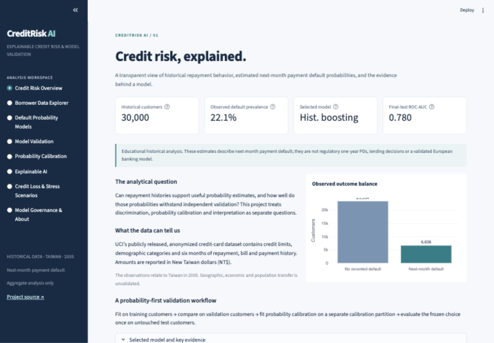
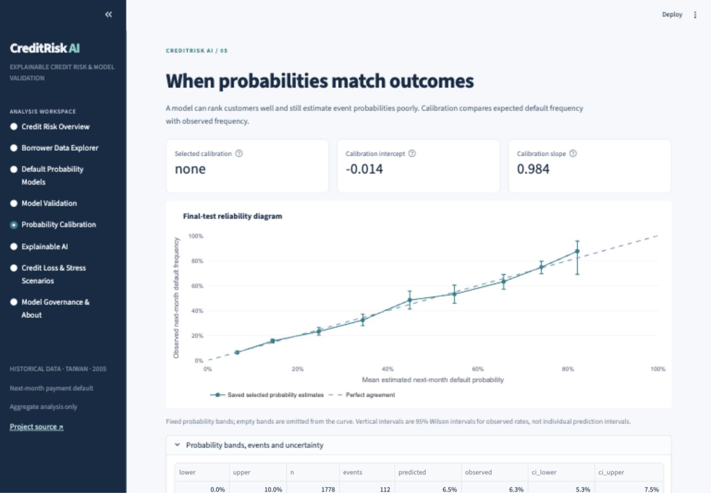
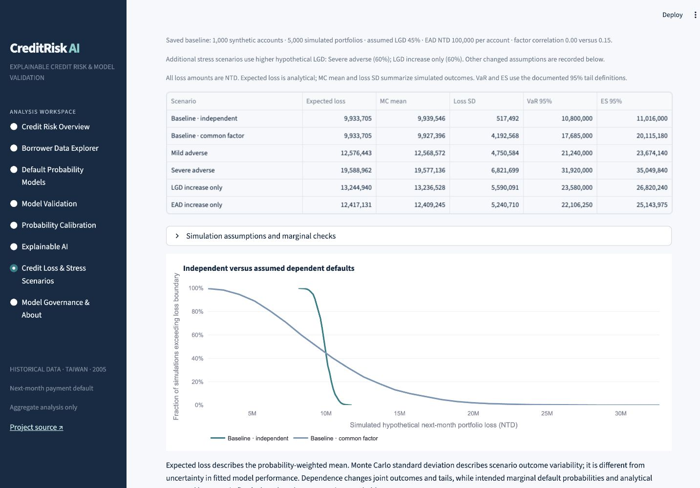
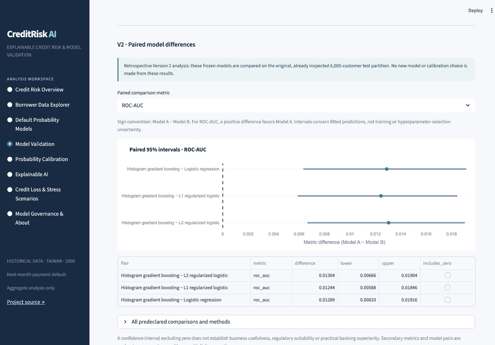

# CreditRisk AI

### Explainable Credit Risk Modeling & Model Validation Platform

A banking-oriented analytics portfolio project by **Priynka Roy**: logistic regression, regularization and nonlinear modeling of historical credit-card repayment, with probability calibration, holdout validation, bootstrap uncertainty, explanations and responsible subgroup diagnostics.

**The target is next-month payment default.** This is an educational historical analytics application, not an underwriting service, regulatory IRB model or IFRS 9 engine. No bank endorses this project.

[Repository](https://github.com/Priynka-Roy/creditrisk-ai-explainable-credit-risk) · [Local app](http://localhost:8503) · [Model card](docs/MODEL_CARD.md) · [Validation report](docs/MODEL_VALIDATION.md)

The local link works while you run the server on your own computer. The owner will deploy to Streamlit Community Cloud after review; no public URL is claimed.

Quality checks: **112 tests pass**, Ruff passes, 12 V2 and seven preserved V1 fingerprints verify, and [Linux CI passes](https://github.com/Priynka-Roy/creditrisk-ai-explainable-credit-risk/actions/runs/38643134133). Version 2 was merged through [PR #1](https://github.com/Priynka-Roy/creditrisk-ai-explainable-credit-risk/pull/1).

## Version 2: inference, simulated risk and governance

Version 2 preserves [the complete V1 baseline](docs/V1_BASELINE.md), tag `v1.0.0` and original artifact/report bytes. It extends the same eight-section app with paired fitted-model comparison intervals, calibration and subgroup uncertainty, 100 development-only logistic resamples, hypothetical Monte Carlo credit losses with common-factor dependence, discrete VaR/Expected Shortfall and illustrative review criteria.

**The original V1 test has already been inspected. Every additional V2 analysis of that test is retrospective.** No new model, feature group, calibration or threshold is selected using it. Simulation assumptions are not observed defaults or measured macroeconomic shocks. Monitoring labels do not approve a model for banking use.

Actual V2 primary boosting−L2 log-loss difference: **−0.008860 [−0.012153,−0.005617]**; KS difference interval includes zero. Overall calibration slope interval: **0.924002–1.045924**. With identical assumed marginals/LGD/EAD, independent versus rho 0.15 simulations share analytical EL **9,933,705 NTD**, while ES95 rises from **11,016,000** to **20,115,180 NTD**. These are retrospective/assumed results, not a newly validated model improvement. All 10 default educational criteria lie within tolerance; changing an assumed AUC floor to 0.80 suggests review rather than certifying performance.

[V2 results](docs/V2_RESULTS.md) · [Paired comparisons](docs/V2_MODEL_COMPARISON.md) · [Calibration uncertainty](docs/V2_CALIBRATION_UNCERTAINTY.md) · [Simulation](docs/V2_RISK_SIMULATION.md) · [Governance / executive model-risk summary](docs/V2_MODEL_GOVERNANCE.md) · [Initial audit](docs/V2_TECHNICAL_AUDIT.md)

To reproduce V2 after downloading the hash-verified source and installing dependencies:

```bash
python scripts/run_v2.py
python scripts/verify_artifacts.py
python scripts/verify_v2_artifacts.py
ruff check .
pytest
```

The script reconstructs the original models/predictions using frozen parameters rather than inventing paired predictions from aggregates. It checks original-metric agreement and file preservation, then writes **separate** `reports/v2/` and `artifacts/v2/` outputs. The registry records seeds, resampling, versions, source/split hashes, runtime, hypothetical assumptions and results. See [methodology](docs/V2_METHODOLOGY.md). Private aligned predictions remain ignored local files; the dashboard receives aggregate evidence only.

## What the project answers

Can historical repayment patterns support useful probability estimates? Does nonlinear modeling improve proper probability scores over interpretable logistic baselines? Does independent recalibration help? How do uncertainty, subgroup differences and hypothetical exposure/loss assumptions change the interpretation?

Eight interactive sections cover credit-risk overview, borrower data exploration, default-probability models, model validation, probability calibration, explainable AI, credit-loss/stress scenarios, and model governance. Plotly charts provide distributions, ROC/PR curves, reliability groups, coefficients, importance and assumed loss sensitivity. Four guided cases explain methods, actual results, banking interpretation and limits.

## Application screenshots





## Dataset and provenance

[UCI Default of Credit Card Clients](https://archive.ics.uci.edu/dataset/350/default+of+credit+card+clients): 30,000 released historical Taiwanese customer records, 23 predictors, April–September 2005 repayment history and binary next-month default. There are 6,636 events (22.12%). Source ID is excluded from modeling and public outputs. Monetary fields are NTD.

Attribution: Yeh, I. (2009). *Default of Credit Card Clients* [Dataset]. UCI Machine Learning Repository. [DOI: 10.24432/C55S3H](https://doi.org/10.24432/C55S3H). Dataset: [CC BY 4.0](https://creativecommons.org/licenses/by/4.0/). Code: [MIT](LICENSE). Original raw files remain unchanged and ignored by Git; SHA-256 hashes, schema checks, unusual codes and all cleaning decisions are documented in the [data card](docs/DATA_CARD.md).

Predictor groups: granted credit, historical demographic coding, six repayment statuses, six bill amounts and six payments. The audit finds no missing cells or duplicate IDs, but 56 repeated predictor patterns; unique customer identifiers do not prove independent observations. Undocumented codes remain separately labeled.

## Evaluation design

A frozen seed-42 stratified customer split allocates 15,000 training, 4,500 validation, 4,500 calibration and 6,000 test observations. This is a random holdout, not invented temporal validation. Preprocessing is fitted within training folds. Three-fold training CV tunes limited L1/L2/boosting grids. Validation chooses features and model by log loss, Brier/AUC guardrails and a documented simplicity preference.

The calibration partition is stratified into fit/selection halves; the chosen mapping is refitted on full calibration without refitting the base model. Test observations choose neither features, model, calibration nor thresholds. [Frozen protocol](configs/protocol.json) and [pre-test decision](reports/frozen_decision.json) preserve the design and realized choices.

**Selected:** histogram gradient boosting, 150 iterations, learning rate 0.05, seven leaves, L2 regularization 10; seven engineered summaries plus ratio-availability indicator. Boosting validation log loss 0.43002 beats the closest logistic candidate by more than the predefined 0.005 simplicity tolerance.

**Calibration result:** no additional calibration was selected. Independent selection log loss is 0.43354 (none), 0.43391 (sigmoid) and 0.45175 (isotonic). Implementing calibration does not imply that it improves probabilities.

## Original V1 untouched-holdout audit (now historical)

The original V1 audit was performed after frozen development decisions. Its customers are no longer a fresh holdout for V2. All numbers below come from [`reports/results.json`](reports/results.json). PR-AUC means average precision, not trapezoidal area. Lower Brier/log loss is better. Model comparisons on this holdout are descriptive audit outputs, not a second selection step.

| Model | ROC-AUC | Average precision | KS | Brier | Log loss |
|---|---:|---:|---:|---:|---:|
| baseline | 0.7675 | 0.5314 | 0.4086 | 0.13785 | 0.43909 |
| l2 | 0.7673 | 0.5346 | 0.4157 | 0.13742 | 0.43805 |
| l1 | 0.7679 | 0.5334 | 0.4110 | 0.13747 | 0.43821 |
| boosting | 0.7804 | 0.5549 | 0.4243 | 0.13499 | 0.42919 |

Selected-path ROC-AUC 95% stratified bootstrap interval: **0.7659–0.7947** (300 replicates). Calibration intercept **−0.0141**, slope **0.9845**, observed/expected defaults **1.0016**. Intervals condition on this fitted model and split; they do not capture population or temporal uncertainty. See [full metrics, thresholds and intervals](docs/MODEL_VALIDATION.md).

## Explanations, responsibility and stability

L2 coefficients/odds ratios explain their transformed model scale, not probability-point or causal effects. Five-repeat boosting permutation importance on validation ranks maximum positive delay and September repayment status first. Correlated predictors limit attribution. [Explanation details](docs/EXPLAINABILITY.md).

Subgroups show counts, event denominators, Wilson intervals, calibration gaps and threshold-dependent error rates. Groups with fewer than 100 observations or 20 events are flagged. Undefined metrics remain unavailable. Historical category disparities do not establish discrimination, and parity does not certify fairness. [Responsible diagnostics](docs/FAIRNESS_AND_RESPONSIBLE_AI.md).

Training/test distribution PSI and 20 training-resampled logistic fits provide within-cohort stability diagnostics. They provide no year-to-year or current-bank stability claim. [Stability report](docs/STABILITY.md).

## Illustrative credit-loss assumptions

`mean(next-month probability) × hypothetical LGD × hypothetical EAD per account × account count`.

For 1,000 assumed accounts and EAD 100,000 NTD each: baseline LGD 45% gives **9,936,454 NTD** modeled loss; assumed 1.5× odds stress with LGD 45% gives **12,579,103 NTD**; assumed 2× odds stress with LGD 60% gives **19,592,343 NTD**. These are hypothetical scenario arithmetic, not observed losses, estimated macroeconomic effects or IFRS 9 calculations. The interactive rounded aggregate probability histogram introduces minor differences from exact saved results. [Assumptions and units](docs/CREDIT_LOSS_SCENARIOS.md).

## Run locally

Python 3.12 is required. Runtime dependencies are pinned and portable to Linux.

```bash
python3.12 -m venv .venv
source .venv/bin/activate
python -m pip install --upgrade pip
python -m pip install -r requirements.txt
python -m pip install -r requirements-dev.txt
python -m pip install -e .
streamlit run streamlit_app.py --server.port 8503
```

Startup reads supplied lightweight aggregate artifacts: no original-data download, training, credentials or real customer input. Cloud configuration contains no fixed local port.

## Reproduce the analytical release

From the activated environment and repository root:

These historical V1 reproduction commands write V1 artifacts. Run them only in an isolated checkout of tag `v1.0.0`; use the V2 command above in the current working tree to preserve the frozen original files.

```bash
python scripts/download_data.py
python scripts/run_pipeline.py
python scripts/export_figures.py
python scripts/verify_artifacts.py
ruff check .
pytest
```

For the recorded development environment, `requirements-lock.txt` captures the resolved dependency set; it excludes the local editable-install path. `requirements.txt` and `requirements-dev.txt` are the direct pinned dependency files.

The downloader verifies known source hashes. The pipeline writes source/schema/split audits, frozen development decisions, final metrics, figures and dashboard artifacts. Training takes longer than opening the app. Raw originals and split IDs remain local/ignored. Library versions and artifact hashes enable audit; floating-point differences across platforms are possible.

## Architecture and technology

- `src/creditrisk/`: validation, features, modeling, calibration, evaluation, explanations, subgroup diagnostics, stability, loss arithmetic and reporting.
- `scripts/`, `configs/`: download/reproduction/integrity workflows and frozen protocol.
- `artifacts/`, `reports/`: aggregate deployable evidence and audit results.
- `app/`, `streamlit_app.py`, `.streamlit/`: eight-section cached Streamlit/Plotly interface.
- `tests/`, `.github/workflows/`: deterministic edge cases and lightweight integration/CI checks without large downloads.

Python, pandas, NumPy, SciPy, scikit-learn, Plotly, Streamlit and pytest/Ruff underpin the implementation. No database, account system, customer upload or API service is needed.

## Deployment and documentation

The owner can deploy `streamlit_app.py`, branch `main`, Python 3.12 to Streamlit Community Cloud after review. [Deployment instructions](docs/DEPLOYMENT.md).

[Data card](docs/DATA_CARD.md) · [Methodology](docs/METHODOLOGY.md) · [Features](docs/FEATURE_ENGINEERING.md) · [Development](docs/MODEL_DEVELOPMENT.md) · [Calibration](docs/CALIBRATION.md) · [Validation](docs/MODEL_VALIDATION.md) · [Model card](docs/MODEL_CARD.md) · [Four guided cases and career descriptions](docs/PORTFOLIO_CASE_STUDY.md) · [Internal five-perspective review](docs/FINAL_REVIEW.md).

## Limits and next steps

Historical Taiwan 2005 results do not validate present-day European borrowers. No true temporal split, measured EAD/LGD, lender approval, causal explanation or regulatory compliance is available. Future work requires properly governed time-stamped cohorts, documented default definitions, external validation and measured exposures/recoveries; see [full limitations and future work](docs/LIMITATIONS.md).

## Version 2 application screens




